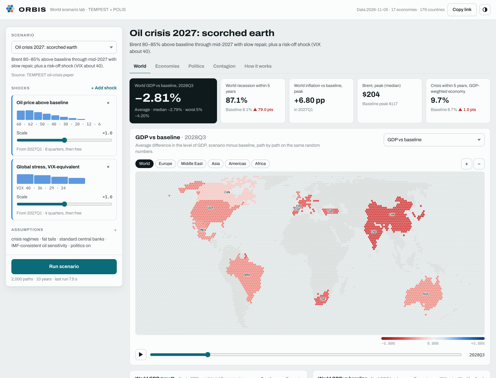
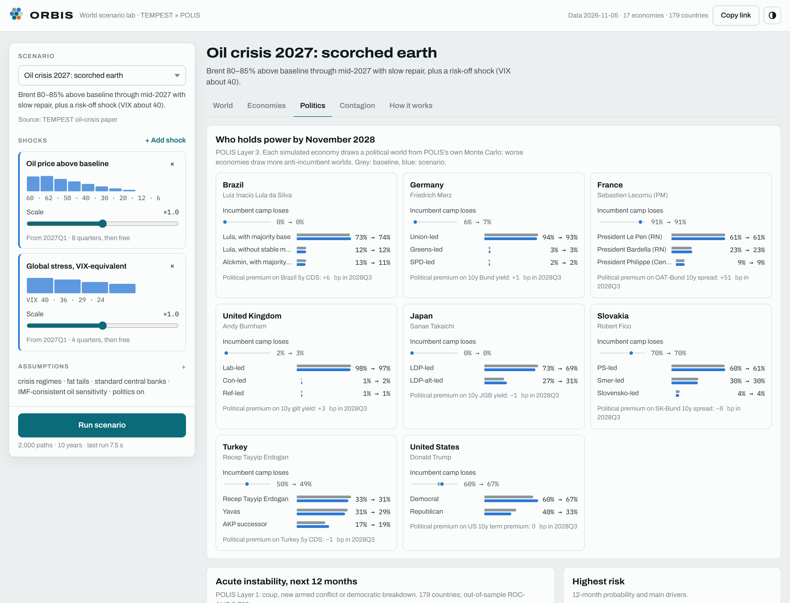

<p align="center"></p>

<h1 align="center">ORBIS</h1>

<p align="center"><strong>A world socio-economic scenario lab.</strong><br>
<a href="https://github.com/auxt/TEMPEST">TEMPEST</a> economies and <a href="https://github.com/auxt/POLIS">POLIS</a> politics, run as one world in your browser.</p>

<p align="center"><a href="https://auxt.github.io/ORBIS/"><strong>Open the app</strong></a> · works offline · installs on iPad, Android and computers · no accounts or tracking</p>



## What it does

Pick a scenario, or build one from shocks, and ORBIS simulates thousands of possible worlds. Each world runs three times on the same random numbers: the baseline, the scenario, and the scenario with politics held at the baseline. You can then see what the scenario does, and how much of that comes from politics reacting to the economy.

- **17 economies** (TEMPEST's 16 plus Slovakia), quarterly to 2036. They include crisis regimes, contagion, banks, sovereign debt and an oil price.
- **8 political systems** (POLIS Layer 3): elections, coalitions, collapses and leadership contests to November 2028. A worse economy draws more anti-incumbent outcomes, and the outcomes feed back into spreads, currencies, demand, inflation and fiscal policy.
- **179 countries** of acute-instability risk (POLIS Layer 1). Unrest in oil producers removes supply and moves the oil price for everyone.

## Views

| View | What you see |
| --- | --- |
| **World** | Five headline numbers. A hex map of any metric, with a time scrubber and play button; pinch or use the region chips to zoom. Fan charts for world growth, inflation, Brent, global stress, and GDP versus baseline with and without political feedback. |
| **Economies** | A sortable table. Each row shows the GDP effect and its bad tail, plus recession, crisis, debt, bank-recapitalisation and market-access risk, and turnover. Download it as CSV. |
| **Politics** | Who holds power by November 2028, baseline against scenario. The instability map and highest-risk list come with their drivers. |
| **Contagion** | A crisis heatmap by economy and quarter, and the network of financial linkages. |
| **Country drawer** | Click any country for small-multiple fan charts, the starting point, POLIS's political card, instability drivers, and the political add-ons to its premium, output and budget. |
| **How it works** | The coupling, the placeholders, the data vintage and the parity results. |



## Scenarios

The presets come from the TEMPEST library, the oil-crisis paper and POLIS:

- **Markets:** global risk-off, US higher for longer, euro sovereign stress, US crisis episode
- **Energy:** oil supply shock, both oil-crisis-2027 variants, Gulf instability
- **Real economy:** China credit bust, stagflation, fiscal stimulus
- **Politics:** anti-incumbent wave, France RN presidency, Slovakia opposition takes power, US Democrat elected, populist shock in Europe

Every shock is editable: size, timing, duration, fade, countries. **Copy link** shares the exact scenario and assumptions.

Assumptions you can change:

- crisis regimes, fat tails, scarring and parameter uncertainty
- contagion strength
- central-bank rule and oil sensitivity
- the political layer and its parts: economy → politics strength, political market impact, instability hazards, the geopolitical oil channel
- paths and horizon

## How it works, in detail

[`GUIDE.md`](GUIDE.md) explains:

- both models block by block
- exactly how they are coupled, with every coefficient and timing rule
- how to read each view, with worked examples
- the full list of limitations

[`DESIGN.md`](DESIGN.md) covers the architecture and the roadmap.

## Run it

```bash
npm install
npm run dev          # local development
npm run site         # build the installable offline app into docs/ (what GitHub Pages serves)
npm run parity       # check the TypeScript engine against Python TEMPEST (10,000 paths)
```

Refresh the data (Python 3.11+, with TEMPEST and POLIS checked out next to this repo):

```bash
pip install -r pipeline/requirements.txt
python pipeline/export_tempest.py --tempest ../TEMPEST    # BIS, IMF, FRED -> src/data/tempest_snapshot.json
python pipeline/export_polis.py --polis ../POLIS          # POLIS Layers 1-4 -> src/data/polis_snapshot.json
```

The `Refresh data and site` GitHub Action does all of this every Monday and commits the rebuilt site. It does not deploy if the parity check fails.

**On iPad:** open the app in Safari, then Share → Add to Home Screen. Open it once online; after that it works offline.

## Repository layout

| Path | Role |
| --- | --- |
| `src/engine/tempest.ts` | TEMPEST blocks and engine, ported line by line from `tempest/blocks.py` and `core.py` |
| `src/engine/politics.ts` | POLIS coupling: political-world pool, analog selection, Layer 4 mapping, Layer 1 hazards, oil channel |
| `src/engine/run.ts` | Three-state lockstep run, scenario shocks, statistics (fans, effects, event probabilities) |
| `src/engine/rng.ts`, `special.ts` | Seeded random numbers (xoshiro128**, Student-t), normal CDF and inverse |
| `src/ui/` | Hex map, charts, scenario rail, views, country drawer |
| `src/scenarios.ts` | Scenario library, shock catalogue, default assumptions |
| `src/data/` | Snapshots exported by the pipeline, and the hex world |
| `pipeline/` | Python exporters (import TEMPEST and POLIS unchanged) and the ORBIS overlay (Slovakia) |
| `scripts/` | Parity check, hex-world builder, PWA builder |
| `reference/` | Python reference statistics and the latest parity report |
| `GUIDE.md` | The models, the coupling, how to use ORBIS, limitations |
| `DESIGN.md` | Architecture, coupling, recommendations and roadmap |

## Status and caveats

v0.1, research prototype.

- TEMPEST's behavioural parameters, POLIS's hazards and Layer 4 coefficients, and the coupling constants ORBIS adds are calibrated priors, not estimates.
- Results illustrate mechanisms under stated assumptions. They are not forecasts, and they are not assessments of any government, party, candidate, institution or person.
- Nothing here is investment, financial, legal or policy advice.

## Licence

Code: [MIT](LICENSE) © 2026 Robert Auxt. Data derived from POLIS (V-Dem, poll tables): [CC BY-SA 4.0](LICENSE-DATA.md).

ORBIS, TEMPEST and POLIS were developed with substantial assistance from Claude (Anthropic); the author directed the work and is responsible for its content.
